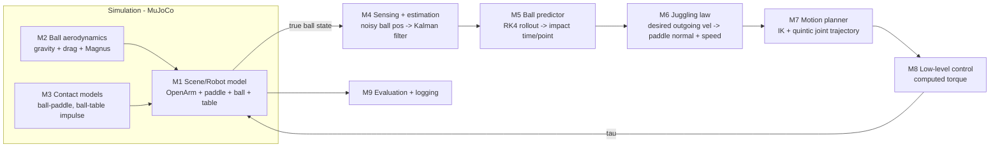

# Table Tennis Robot Simulation — Implementation Plan

> **How to use this file:** put it in the repo root as `CLAUDE.md` so Claude Code reads it automatically. Then ask Claude: *"Read CLAUDE.md and implement Phase 0. Stop after the acceptance checks pass and show me the results."* Work one phase at a time.
>
> **Local setup (VS Code):**
> ```bash
> python -m venv .venv && source .venv/bin/activate      # Windows: .venv\Scripts\activate
> pip install mujoco openarm-mujoco numpy scipy pyyaml matplotlib "imageio[ffmpeg]" pytest
> git init
> ```
> Verified to install cleanly (Oct 2026): Python 3.13, `mujoco` 3.17.0, `openarm-mujoco` 2.3.0.
> Interactive viewer: `python -m mujoco.viewer` (on macOS use `mjpython` instead of `python` for any script that opens a viewer window).
>
> **Remote headless Linux server (VS Code Remote-SSH) — this project's actual setup:**
> - Check first: `python3 --version` (need ≥ 3.10; use conda/uv if the system Python is older) and `nvidia-smi` (GPU present?).
> - Rendering without a display: GPU → `export MUJOCO_GL=egl`; no GPU → `export MUJOCO_GL=osmesa` (needs `libosmesa6`; if there is no sudo, `conda install -c conda-forge mesalib`). Put the export in `~/.bashrc`. Smoke test: render one frame of the scene to a PNG.
> - The interactive viewer does not work over plain SSH. Debug with rendered MP4s/PNGs (open them in VS Code's file explorer, or download). For a live viewer, either copy the repo to the laptop and run `python -m mujoco.viewer` there (the code is pure Python and portable), or use X11 forwarding / VNC as a last resort (slow).
> - Run long jobs (Monte Carlo, training) inside `tmux` so they survive SSH disconnects; write all outputs to `results/`.
> - Push to a private GitHub repo after each phase so the laptop copy (for the live demo) stays in sync.

---

## 0. Instructions for the AI assistant implementing this plan

1. **Work phase by phase.** Each phase ends with acceptance checks. Do not start the next phase until they pass. Report results (numbers + plots) at the end of each phase.
2. **Verify, don't assume.** Before using any external repo or API (OpenArm MJCF file names, actuator types, joint limits, MuJoCo function signatures, mink API), open the source or docs and check. Never invent file paths or parameter values.
3. **All physical parameters live in `config/default.yaml`**, each with a comment giving its source (paper, ITTF rule, measured in sim, or "assumed — tunable").
4. **No magic numbers in code.** Every tunable gain or threshold goes in the config.
5. **Seeded randomness.** Every stochastic run takes a seed; Monte Carlo results must be reproducible.
6. **Log everything** to CSV/NPZ (time, ball true state, ball measured state, estimate, paddle pose/velocity, q, q̇, τ, contact events). Plots are generated from logs, never from live sim.
7. **Visualization.** The project runs on a **headless remote Linux server**. Every runnable script takes `--video PATH` (offscreen `mujoco.Renderer` → MP4) and `--snapshot PATH` (single PNG), and also `--viewer` (interactive `mujoco.viewer.launch_passive`) for when the code is run on the user's laptop. Default is headless. Never assume a display exists; check `MUJOCO_GL` is set (`egl` with GPU, `osmesa` without) and say so if rendering fails. Videos: 30–60 fps, a camera that shows paddle and ball apex, and a slow-motion option around impacts.
8. If something in this plan turns out to be wrong (e.g., the OpenArm model has position actuators, not torque actuators), **stop and tell the user** instead of silently working around it.
9. **Git.** Commit at the end of every phase (`git commit -m "Phase N: <summary>"`) once its acceptance checks pass.
10. **Explain as you go.** At the end of each phase, give the user a short explanation of what each new file does and the key equations, so they can answer audience questions about it. The user must understand every module.

---

## 1. Project brief (from the course)

- Simulate a table tennis robot: OpenArm (https://github.com/enactic/openarm) or another suitable arm, **modified to carry a table tennis paddle**.
- Simulator: MuJoCo / Isaac Lab / mjlab. **We use MuJoCo (Python bindings)** for the core; mjlab only if we attempt RL.
- No camera perception. Use simulator ball state **plus explicitly specified measurement noise**.
- Focus: **replicate existing results**.
- Core task: **bounce (juggle) a ball on the paddle with a heuristic control law.**
- Extra credit: **two robots playing each other** using MPC or RL.

### Grading criteria → where each is satisfied

| # | Criterion (pts) | Modules | Evidence to produce |
|---|---|---|---|
| 1 | Architecture map (8) | all | Block diagram (Section 3), one slide per module: function, method, inputs/outputs |
| 2 | Ball dynamics + ball–table + ball–racket contact (3) | M2, M3 | Equations, parameter table w/ sources, drop-test plot, ballistic validation plot, paddle-rebound test plot |
| 3 | Robot dynamics simulation (3) | M1, M8 | Model description (DOF, torque limits, paddle mass/inertia), torque-control tracking plots |
| 4 | Planning and control (3) | M5–M8 | Predictor, juggling law derivation, IK + trajectory, computed-torque control; tracking error plots |
| 5 | Juggling performance (3) | M9 | Consecutive bounces, apex-height error, lateral drift, noise sweep, comparison table vs papers, video |

---

## 2. Key design decisions (and why — useful for Q&A)

| Decision | Choice | Rationale |
|---|---|---|
| Simulator | MuJoCo ≥ 3.2, Python | Official OpenArm MJCF exists (`pip install openarm-mujoco`); transparent; fast enough on CPU |
| Robot | OpenArm, **single arm**, 7-DOF, torque-controlled | The OpenArm MuJoCo model uses torque actuators (verify in Phase 0) |
| Ball–paddle contact | **Analytic impulse model**, MuJoCo collision disabled for ball↔paddle | MuJoCo has no restitution coefficient; soft-contact bounce of a 2.7 g ball is hard to tune and hard to explain. An event-based impulse law is standard in the table tennis literature (Nakashima et al.) and easy to defend |
| Ball–table contact | Same analytic impulse model (normal restitution + tangential friction) | Consistent code path; table only matters for the extra-credit rally |
| Aerodynamics | Gravity + quadratic drag (+ optional Magnus) applied via `data.xfrc_applied` | Explicit, testable equations; spin optional |
| Low-level control | Computed torque (inverse dynamics + PD) | Matches MIT MPC paper [4]: invert fully actuated arm dynamics for feed-forward torque |
| Juggling law | Analytic "impact-targeting" law (Section 6) | Closed-form, derived from the contact model; equivalent in spirit to [2,3,7,10] |
| Extra credit | MPC swing (CasADi/acados) — primary; RL (mjlab, PPO) — stretch | No public table-tennis MPC code exists; MIT formulation [4] is reproducible. RL has better existing code (PACE) but more porting risk |

**Note on references:** the brief cites [9], [10], [11] for the juggling task, but those are mainly about hitting/returning balls. The juggling-specific references are [1] Hexa-Bouncer, [2]/[3] Nakashima paddle juggling, and [7] Ji et al. 2024 juggling robot. Use [10] for the "hitting velocity control" idea in M6.

### Open questions to confirm with the instructor (before or during Day 1)
1. Is an analytic, mirror-law-style juggling controller acceptable as "the heuristic control law", or is a specific law from [9]/[10]/[11] expected?
2. Is an analytic impulse contact model acceptable, or must ball–paddle contact use the simulator's native contact? (Phase 3 includes an optional native-contact comparison to cover both.)
3. What counts as "replicating existing results": same method + same metrics compared against a paper's numbers, or reproducing a specific figure?
4. Is position-only noisy measurement acceptable, or should the simulated sensor also provide (noisy) velocity?

---

## 3. Architecture (modules)



| Module | Function | Method | Inputs → Outputs |
|---|---|---|---|
| M1 Scene | Robot + paddle + ball + table model | MJCF composition (MjSpec or edited copy of OpenArm MJCF) | — → `MjModel` |
| M2 Aerodynamics | Ball flight | F = m g − ½ρC_dA‖v‖v + k_M (ω × v), applied each step via `xfrc_applied` | ball state → force |
| M3 Contact | Ball–paddle and ball–table impacts | Event detection + velocity-level impulse (restitution e, tangential coeff.) | ball state, paddle pose/vel → post-impact ball vel/spin |
| M4 Sensing/estimation | Realistic measurements | Gaussian noise + optional latency/dropout; linear KF [p, v] with gravity input | true pos → estimated pos/vel + covariance |
| M5 Predictor | When/where ball reaches hit plane | RK4 rollout of nominal ball model (drag included) | estimate → (t*, p*, v_in) |
| M6 Juggling law | What the paddle must do at impact | Closed-form from contact model (Section 6) | (p*, v_in, target) → paddle normal n, normal speed v_p·n |
| M7 Planner | Joint trajectory to achieve paddle state at t* | IK (mink or damped least squares) for q*, q̇* = J⁺ ẋ*; quintic from current desired state; re-plan until freeze time | (t*, pose, twist) → q_d(t), q̇_d(t), q̈_d(t) |
| M8 Control | Track trajectory | τ = M(q)(q̈_d + K_p e + K_d ė) + h(q, q̇) via `mj_inverse`/`mj_fullM`; null-space posture term | q_d, q → τ |
| M9 Evaluation | Metrics, plots, videos | Monte Carlo over seeds and noise levels | logs → figures/tables |

---

## 4. Physical parameters (initial values for `config/default.yaml`)

| Parameter | Value | Source / status |
|---|---|---|
| Ball mass | 2.7 g | ITTF regulation ball |
| Ball radius | 20 mm (40 mm diameter) | ITTF |
| Air density ρ | 1.2 kg/m³ | standard |
| Drag coefficient C_d | ~0.4–0.5 | literature range, tunable; cite Nakashima et al. 2010 aerodynamics paper |
| Magnus coefficient k_M | 0 for core juggling; literature value if spin is enabled | optional |
| Table restitution e_t | ≈ 0.88 | ITTF table rule: ~23 cm bounce from a 30 cm drop → e = √(23/30) ≈ 0.88 |
| Paddle restitution e_r | 0.8 (sweep 0.7–0.9) | assumed, tunable; varies with rubber |
| Paddle tangential coefficient | small (e.g. 0.1–0.3) or 0 for frictionless baseline | assumed; Nakashima rebound model for the full version |
| Paddle geometry | disk, radius ≈ 75 mm, thickness ≈ 6–10 mm | standard blade size |
| Paddle mass | ≈ 0.1–0.17 kg (incl. handle) | assumed; set inertia of a thin disk |
| Physics timestep | 1 ms (try 0.5 ms if impacts are missed) | |
| Control rate | 1 kHz (torque), planner re-plan 100 Hz | |
| Ball sensor | 200 Hz, i.i.d. Gaussian position noise σ = 2 mm per axis (baseline); sweep σ ∈ {0, 1, 2, 5, 10} mm; optional latency 0/10 ms; optional 2% dropouts | **this is the "clearly specified measurement noise"**; velocity is NOT measured, it is estimated (optional variant if the instructor prefers full ball-state measurements: also measure velocity with σ_v = 0.05 m/s, assumed) |
| Target apex height above hit plane | 0.4 m | design choice; gives ~2.8 m/s impact speed |

Sanity check to put on a slide: with h = 0.4 m, v_in·n ≈ −2.8 m/s, v_out·n ≈ +2.8 m/s, e = 0.8 → required paddle normal speed = (2.8 + 0.8·(−2.8))/1.8 ≈ **0.31 m/s**. Juggling is gentle; arm torque limits are not the bottleneck.

---

## 5. Contact model (M3) — equations

At each physics step, express ball center in the paddle frame (normal n along paddle z-axis). Contact event when: −t_paddle/2 − r_ball ≤ z_local ≤ t_paddle/2 + r_ball, ‖xy_local‖ ≤ R_paddle, and relative normal velocity (v_ball − v_paddle,contact)·n < 0. Apply **one** impulse per approach (debounce until the ball separates). **Tunneling guard:** also trigger if the signed gap z_local − (t_paddle/2 + r_ball) changed sign between the previous and current step; in that case first move the ball back onto the contact surface along n, then apply the impulse.

Relative velocity at contact point: v_rel = v_ball − v_p, with v_p = paddle linear velocity at the contact point (use `mj_objectVelocity`; note it returns [angular; linear] — verify ordering).

- Normal: v_rel,n⁺ = −e · v_rel,n⁻
- Tangential (baseline, frictionless): v_rel,t⁺ = v_rel,t⁻
- Tangential (full, Nakashima-style): v_rel,t⁺ and ω⁺ updated with a tangential coefficient including the spin term r ω × n; document the exact form used and cite [2]/[3] and Nakashima's rebound modeling paper.

Write the result directly into the ball freejoint `qvel` (first 3 = linear velocity in world frame, last 3 = angular velocity in the **body-local** frame — verify against MuJoCo docs). Disable MuJoCo collisions between ball and paddle/table via `contype`/`conaffinity`. The ball's mass is negligible relative to the paddle, so ignoring the reaction force on the arm is acceptable (state this assumption).

Same model for the table, with e_t and the table normal (+z).

**Optional native-contact comparison (recommended, one slide):** also build a variant where ball↔paddle and ball↔table use MuJoCo's own soft contact, with `solref` in "direct" form (negative values: −stiffness, −damping) and `solimp` tuned so the 0.3 m drop test gives the same rebound ratio, and `condim=6` + `priority` so spin/rolling friction is available. Compare drop-test rebound, contact duration, and sensitivity to timestep against the analytic model. This turns "you bypassed the simulator's contact" into a comparison result. Likewise, MuJoCo's built-in fluid model (`<option density=... viscosity=...>`, `fluidshape="ellipsoid"`) can be used as a cross-check of the explicit drag force in M2.

---

## 6. Juggling law (M6) — derivation

Let v_in = ball velocity just before impact (from M5), v_out = desired ball velocity just after. For the frictionless impulse model above, the velocity change is along n, so:

- **Paddle normal:** n = (v_out − v_in) / ‖v_out − v_in‖
- **Paddle normal speed:** v_p·n = (v_out·n + e · v_in·n) / (1 + e)

Choosing v_out (the "heuristic" part):

- Vertical: v_out,z = √(2 g h_des) (drag-free; optionally correct for drag by shooting with the M5 model).
- Horizontal: return the ball toward the juggling center c at the next impact. With flight time T = 2 v_out,z / g (same impact height), set v_out,xy = k_c · (c − p*_xy) / T, with gain 0 < k_c ≤ 1. k_c = 1 is deadbeat (ball lands exactly on c in one bounce, but passes all noise through); k_c ≈ 0.5 is smoother. Since v_out is commanded directly, no separate velocity-damping term is needed: the incoming horizontal velocity is cancelled automatically by the choice of n.
- Limit paddle tilt to e.g. ≤ 20° for robustness (saturate v_out,xy accordingly).
- Note: in the frictionless model the tangential velocity is unchanged, so n must be parallel to (v_out − v_in); that is why n is fully determined by v_in and v_out. With the friction model, solve for n numerically (a 2-D root find over tilt angles using M3).

This is a mirror-law-style controller. Alternative to implement for comparison (optional): the PD tilt law used in paddle-juggling papers (paddle tilt angles proportional to the ball's horizontal position/velocity error). Comparing the two laws is a nice result slide.

Impact plane: fixed height z_h in the arm's dexterous workspace (find it in Phase 4). The paddle meets the ball at z_h, then follows through and decelerates.

---

## 7. Repository layout

```
tt_sim/
  CLAUDE.md                 # this plan
  config/default.yaml
  assets/
    scene.xml               # table, ball, includes/attaches OpenArm + paddle
  tt/
    model.py                # M1 scene build (MjSpec), ids/lookups
    aero.py                 # M2
    contact.py              # M3
    sensing.py              # M4 noise + Kalman filter
    predictor.py            # M5
    juggle_law.py           # M6
    planner.py              # M7 IK + quintic + replanning
    control.py              # M8 computed torque
    sim.py                  # main loop (physics 1 kHz, planner 100 Hz, sensor 200 Hz)
    log_utils.py, metrics.py  # M9 (not "logging.py": that would shadow Python's stdlib module)
  scripts/
    inspect_model.py        # Phase 0
    view_scene.py           # Phase 1: open the scene in the interactive viewer
    validate_ballistics.py  # Phase 2
    drop_tests.py           # Phase 3
    tracking_test.py        # Phase 4
    juggle.py               # Phases 5-6 (single run; --viewer / --video / --noise)
    monte_carlo.py          # Phase 7
    make_figures.py
  tests/                    # pytest for each module
  extra/
    mpc_swing.py            # E1
    rally.py                # E2
    rl/                     # E3 (mjlab)
  results/                  # logs, figures, videos (gitignored except final)
```

Dependencies: `mujoco`, `openarm-mujoco`, `numpy`, `scipy`, `pyyaml`, `matplotlib`, `imageio[ffmpeg]`, `mink` (IK, https://github.com/kevinzakka/mink), `pytest`. Extra credit: `casadi` and/or `acados_template`; RL: `mjlab`.

---

## 8. Phases with acceptance checks

### Day 1

**Phase 0 — Setup and model inspection (~1 h)**
- Install deps; load the OpenArm MJCF from `openarm-mujoco` (check which versions/files exist: v2, v1, bimanual vs single arm).
- `scripts/inspect_model.py` writes `results/model_report.md`: joint names, ranges, actuator types and ctrl/force ranges, end-effector body/site, link masses, total DOF.
- ✅ Report exists; confirm actuator type (torque vs position). If position actuators, ask the user before converting.

**Phase 1 — Scene with paddle (~2 h)**
- Single arm (remove or park the second arm if only a bimanual file exists). Remove the gripper or attach the paddle at the flange: paddle = thin cylinder geom (+ optional handle box) with correct mass/inertia, plus a site `paddle_center` with z-axis = paddle normal.
- Add ball (freejoint, sphere r = 20 mm, m = 2.7 g) and table (2.74 × 1.525 m top at 0.76 m; needed for extra credit).
- Also check: actuator torque limits with the paddle attached (gravity torque at the ready pose must be well inside limits), and whether the OpenArm v2 end effector is a gripper that must be removed or replaced at the flange.
- ✅ Scene loads and renders (`scripts/view_scene.py --viewer` locally, `--video` headless); with gravity compensation + joint PD (τ = bias forces + PD) the arm holds a ready pose with the paddle horizontal facing up; drift < 1 mm over 2 s.

**Phase 2 — Ball dynamics (~1.5 h)**
- Implement M2 via `xfrc_applied`.
- ✅ `validate_ballistics.py`: MuJoCo trajectory vs an independent RK4 integration of the same ODE, position error < 1 mm over 1 s, for 3 initial conditions; plot. With drag off, matches the analytic parabola.

**Phase 3 — Contact models (~2 h)**
- Implement M3 for paddle and table.
- ✅ Drop on a static horizontal paddle from 0.3 m: rebound height ratio ≈ e² (within 2%).
- ✅ Drop on the table from 0.30 m: rebound ≈ 0.23 m.
- ✅ Moving paddle (prescribed velocity) and tilted paddle: outgoing velocity matches the Section 6 formula within 1%.
- ✅ No double impacts (event count test).

**Phase 4 — Robot control (~2.5 h)**
- IK for a paddle pose (position + normal; rotation about the normal is free → use it as a redundancy or fix it), joint-space quintic, computed-torque controller with null-space posture.
- Find a good hit plane height z_h and ready pose (high manipulability, far from joint limits).
- ✅ `tracking_test.py`: command a vertical stroke reaching 1.0 m/s paddle speed at a specified time and pose. Paddle position error at impact < 2 mm, normal error < 1°, timing error < 2 ms, torques within actuator limits. Plot q, q̇, τ, task-space errors.

**Phase 5 — First juggle with the TRUE ball state (~2–3 h; end of Day 1 or first thing Day 2)**
- Goal: a working end-to-end demo as early as possible. The predictor (M5) and juggling law (M6) use the simulator's exact ball state; no noise, no filter yet.
- Loop: predict (t*, p*, v_in) → juggling law → re-plan joint trajectory at 100 Hz until a freeze time (~30–50 ms before impact) → follow-through → return to ready pose.
- Start: ball dropped from 0.5–0.8 m above the paddle, random horizontal offset ±5 cm.
- ✅ ≥ 200 consecutive bounces, apex height error < 1 cm, ball stays within ±3 cm of the center.
- Video: `results/juggle_nominal.mp4`. **Commit — from here on there is always something to present.**

### Day 2

**Phase 6 — Sensing, estimation, and juggling with noise (~2.5 h)**
- Noise model from Section 4; KF with state [p, v] and gravity as known input (drag as process noise, or an EKF with drag). Reset/inflate covariance after a contact event (the estimator detects the bounce from the innovation jump or the predicted impact time; it must not read the simulator's contact flag).
- Switch M5/M6 inputs from true state to the estimate.
- ✅ With σ = 2 mm: steady-state velocity RMSE reported; predicted impact point error (at 100 ms before impact) reported and plotted vs time-to-impact.
- ✅ Juggling with σ = 2 mm: report the Phase 5 metrics (no hard threshold, but aim for ≥ 100 bounces).
- Video: `results/juggle_noisy.mp4`.

**Phase 7 — Evaluation (~2 h)**
- Monte Carlo: N = 50 seeds per condition.
  - Noise sweep σ ∈ {0, 1, 2, 5, 10} mm.
  - Latency 0 vs 10 ms.
  - Model mismatch: true e_r ≠ nominal e_r (±0.1); true C_d ≠ nominal.
  - Law comparison: impact-targeting law vs PD-tilt law (if implemented).
- Metrics: bounces until failure (cap 200), apex height mean/std, horizontal dispersion (RMS), impact timing error, peak torque, success rate.
- ✅ Figures: survival curve (bounces), apex-height histogram, dispersion scatter, metrics vs σ.
- **Replication table:** extract the reported juggling metrics from [2]/[3] and [7] (read the papers — do not invent numbers) and put them next to ours, noting the differences (real robot + vision vs sim + noise model).

**Phase 8 — Presentation material (~1 h)**
- Architecture diagram (Section 3), one slide per module, parameter table with sources, contact model equations, juggling law derivation, noise specification, results, videos, limitations.
- Q&A prep list (Section 11). Then ask Claude to quiz the user module by module (derivations, design choices, failure modes) until they can answer without notes.

---

## 9. Extra credit — two robots playing each other

Do this only after Phase 7 is done.

**E1 — MPC swing for one arm (~4–6 h).** Reproduce the formulation of Nguyen, Cancio, Kim [4]:
- Ball predictor now includes the table bounce. Choose a hitting plane behind the robot's table end.
- Choose a landing target on the opponent side; solve for the required outgoing ball velocity by shooting with the M2 model (fixed flight time or fixed apex).
- Paddle normal and normal speed from the Section 6 formula.
- OCP over joint states (double integrator, controls = q̈): minimize ∫‖q̈‖² (or jerk); constraints: joint position/velocity/acceleration limits, **terminal paddle pose via FK** and **terminal paddle velocity J(q) q̇**, at time t*. Solve with CasADi (IPOPT) first; switch to acados SQP-RTI if too slow. Re-solve at 50–100 Hz with a shrinking horizon as the prediction updates.
- FK for CasADi: build symbolic FK from the MuJoCo model's body offsets and joint axes (product of exponentials) and unit-test against `mj_kinematics` at random q (error < 1e-6). Alternative: Pinocchio's CasADi interface from the OpenArm URDF, if a URDF is available.
- Track the MPC output with M8 (feed-forward torque from inverse dynamics, as in [4]).
- Incoming balls: sample from the DeepMind initial ball-state dataset (convert their coordinate frame: origin at table center, table top at z = 0) or from a simple launcher distribution.
- ✅ Hit rate and landing-error statistics over 100 balls.

**E2 — Rally (~2 h).** Two OpenArms facing each other across the table (with net), each running E1. Metric: rally length distribution, landing error.
- Reach: a single fixed arm cannot cover a 1.525 m-wide table. Either (a) mount each arm on a lateral prismatic rail (as the DeepMind and Sony systems do with linear axes / gantries; state this model modification), or (b) restrict landing targets to a corridor the arm can reach and call it a cooperative rally.
- Speed: check in Phase 0 whether OpenArm's torque/velocity limits allow realistic return speeds. If not, use a slower, higher-arc cooperative rally and say so.

**E3 — RL (stretch, use cloud GPU).** Single-arm return task on OpenArm in mjlab (MuJoCo Warp) with PPO, borrowing:
- PACE's physics-based predictor for dense rewards and its aerodynamics implementation.
- Sony Ace's asymmetric actor-critic idea (critic sees true state, actor sees noisy estimates).
- Action space: residual joint targets on top of the M7 planner (much easier to train than raw torques).
- Mirror the trained policy to the second arm for a self-play rally.

**Safety constraints (optional, worth one slide):** joint position/velocity/torque limits as hard MPC constraints, paddle–arm and arm–arm collision avoidance, workspace bounds. A control-barrier-function safety filter on the RL policy is a natural extension.

---

## 10. References and code

### Course references
1. T. Kuhn, Hexa-Bouncer — https://github.com/T-Kuhn/Hexa-Bouncer (Unity/C#; ball-bouncing timing + paddle-angle logic)
2. A. Nakashima, Y. Sugiyama, Y. Hayakawa, "Paddle Juggling of one Ball by Robot Manipulator with Visual Servo," ICARCV 2006. doi:10.1109/ICARCV.2006.345164
3. A. Nakashima, Y. Sugiyama, Y. Hayakawa, "Paddle Juggling by Robot Manipulator with Visual Servo," in *Robot Manipulators*, InTech 2008. doi:10.5772/6218
4. D. Nguyen, K. D. Cancio, S. Kim, "High Speed Robotic Table Tennis Swinging Using Lightweight Hardware with Model Predictive Control," arXiv:2505.01617 (ICRA 2025). https://arxiv.org/abs/2505.01617 — see also D. Nguyen, MIT S.M. thesis "Model Predictive Control Approaches for Dynamic Table Tennis Swinging," https://hdl.handle.net/1721.1/163436
5. P. Dürr et al., "Outplaying elite table tennis players with an autonomous robot," *Nature* 652, 2026. doi:10.1038/s41586-026-10338-5
6. X. Hu et al., "Catching spinning table tennis balls in simulation with end-to-end Curriculum RL," EAAI 2025. arXiv:2503.01251
7. Y. Ji et al., "Design, Modeling, and Experimental Validation of a Vision-Based Table Tennis Juggling Robot," *Mathematics* 12(11), 2024. doi:10.3390/math12111634
8. Y. Ji et al., "Opponent Hitting Behavior Prediction and Ball Location Control for a Table Tennis Robot," *Biomimetics* 8(2), 2023. doi:10.3390/biomimetics8020229
9. D. Büchler et al., "Learning to Play Table Tennis From Scratch Using Muscular Robots," IEEE T-RO 38(6), 2022. doi:10.1109/TRO.2022.3176207
10. Y. Ji et al., "Model-Based Trajectory Prediction and Hitting Velocity Control for a New Table Tennis Robot," IROS 2021. doi:10.1109/IROS51168.2021.9636000
11. W. Gao et al., "Robotic Table Tennis with Model-Free Reinforcement Learning," IROS 2020. doi:10.1109/IROS45743.2020.9341191

### Additional papers
- D. B. D'Ambrosio et al. (Google DeepMind), "Achieving Human Level Competitive Robot Table Tennis," ICRA 2025. arXiv:2408.03906
- Z. Su et al., "HITTER: A HumanoId Table TEnnis Robot via Hierarchical Planning and Learning," arXiv:2508.21043
- M. Hu et al., "PACE: Physics Augmentation for Coordinated End-to-end RL toward Versatile Humanoid Table Tennis," ICRA 2026. arXiv:2509.21690
- "Whole-Body Model Predictive Control for Spin-Aware Quadrupedal Table Tennis" (RAI Institute, Spot), arXiv:2510.08754 — CasADi + SQP/OSQP implementation details
- A. Nakashima et al., "Analysis of effects of rebounds and aerodynamics for trajectory of table tennis ball," SICE 2010 — aerodynamic and rebound coefficients
- Nakashima et al., "Modeling of rebound phenomenon between ball and racket rubber with spinning effect," ICCAS-SICE 2009 — racket contact model

### Code to reuse

| Repo | What it gives us | Status |
|---|---|---|
| `enactic/openarm_mujoco` (`pip install openarm-mujoco`) | OpenArm MJCF (v2, v1, bimanual) | official; torque actuators |
| https://github.com/kevinzakka/mink | IK on MuJoCo models | library |
| `ALRhub/fancy_gym` → `fancy_gym/envs/mujoco/table_tennis/` | MuJoCo table tennis env (7-DOF arm, return-to-goal task); reference for table/ball/env structure | runnable |
| `purdue-tracelab/PACE-ICRA2026` | Isaac Lab table tennis env, air-drag module (`legged_lab/physics/aerodynamics.py`), physics predictor, PPO + prediction-augmented PPO | runnable; humanoid (Booster T1); requires **Isaac Sim 4.5.0 + Isaac Lab 2.1.0** (authors report degraded results on 5.0+); MIT license |
| `SonyResearch/ace_public` | Approximate Python (TensorFlow) for SAC training loop with asymmetric actor-critic, rollout worker, GA serve pipeline, ball state estimator; match dataset | pseudocode, not runnable |
| `google-deepmind/competitive_robot_table_tennis` | 15,792 real initial ball states (rallies + serves) + notebook rolling them out in MuJoCo | data; archived (read-only) |
| `mujocolab/mjlab` | GPU RL framework on MuJoCo Warp, Isaac Lab-style managers | for E3 |
| https://github.com/acados/acados, CasADi | MPC/OCP solvers | for E1 |
| `DrMainIT/pingpong_arm` | Small MuJoCo + SB3 PPO table tennis env | unfinished; author reports no reliable rallies; template only |
| MuJoCo discussion #2131 (google-deepmind/mujoco) | Example of a spinning ball bouncing in MuJoCo's native contact | reference if we ever replace the analytic contact |

